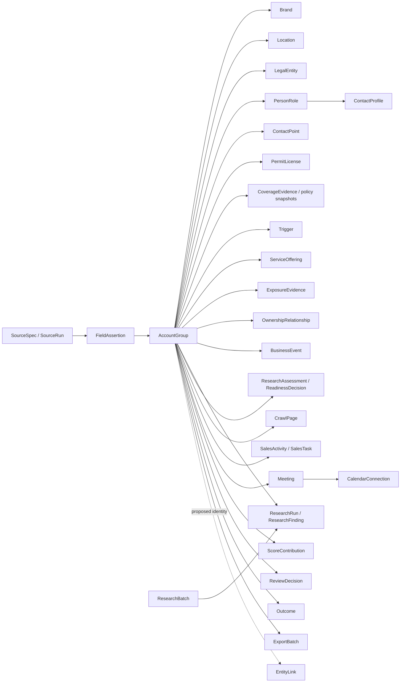

# Evidence graph and retention

`AccountGroup` is the insurable owner-controlled operation. It aggregates brands, premises, and legal entities across state lines. Source records do not overwrite this graph directly; they add normalized records and append-only `FieldAssertion` rows.

Each assertion includes source ID, source record ID/URL, retrieval time, source authority, parser version, confidence, SHA-256 content hash, retention class, optional excerpt, and conflict flag. Differing singleton assertions remain present and are marked as conflicts.

Research findings have a proposed/accepted/rejected lifecycle with decision time, user, notes, and the materialized record identifier. Accepting a finding creates a new derived assertion; it does not promote AI evidence to official or first-party authority. Provider rate cards and per-run usage keep the AI authorization ceiling separate from calculated micro-USD cost.

Policy identifiers are never stored in full. A salted HMAC supports equality checks and a last-four mask supports human review. Home addresses and personal phones are not export fields. Suppression keys are normalized and checked for every later export.

`ResearchAssessment` is an immutable rubric snapshot for a run. Dimension state is one of `not_started`, `in_progress`, `found`, `attempted_no_evidence`, `stale`, or `conflict`; `AccountGroup` caches only the latest state and timestamps. `ReadinessDecision` retains every manual override reason and actor. `CrawlPage` retains URL/canonical metadata, conditional-request validators, content hash, robots state, status, and errors—not full HTML.

`ContactProfile` contains only manual relationship fields and remains separate from sourced `PersonRole` identity evidence. `CoverageEvidence` is append-only: a correction points to the prior snapshot through `supersedes_id`, and current status is derived from the latest non-superseded row per coverage type. Activities, follow-ups, meetings, and policies all retain the same `AccountGroup` foreign key after prospect-to-client conversion.

Calendar uses split authority. `Meeting` keeps private preparation and account linkage locally. `CalendarConnection` keeps one AES-GCM-encrypted refresh token and incremental sync token. Google event IDs are deterministic, and private extended properties contain only local meeting/account identifiers; research, relationship, and policy notes are excluded from event payloads.

Exports are versioned snapshots. `manifest.json` carries filters, generation time, scoring version, file list, lead count, and a deterministic fingerprint of all tabular rows. The generation timestamp identifies the batch; the snapshot fingerprint proves equal inputs produced equal normalized results.
